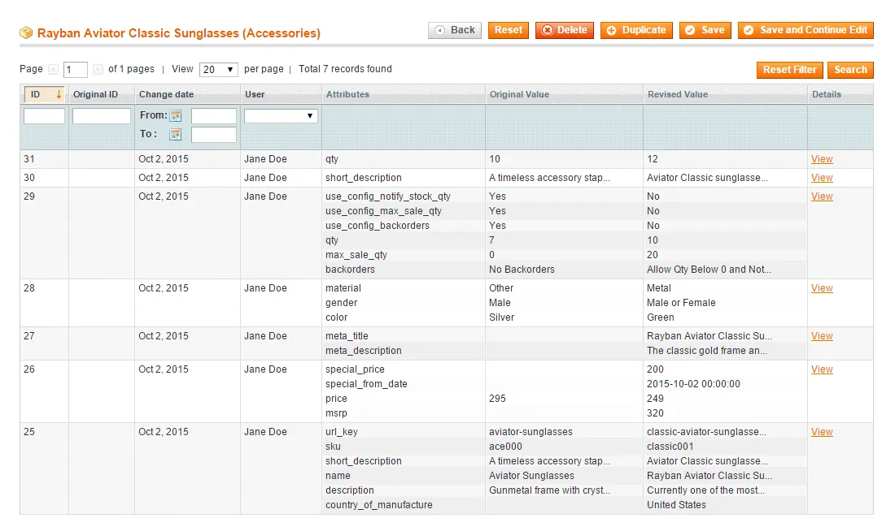
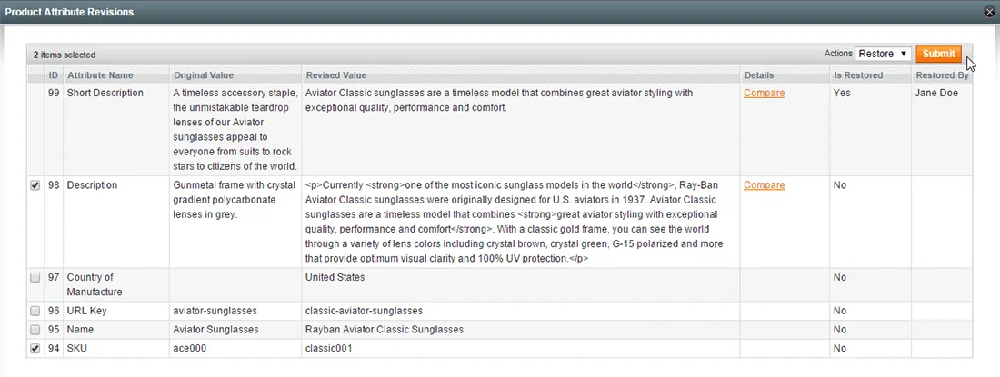
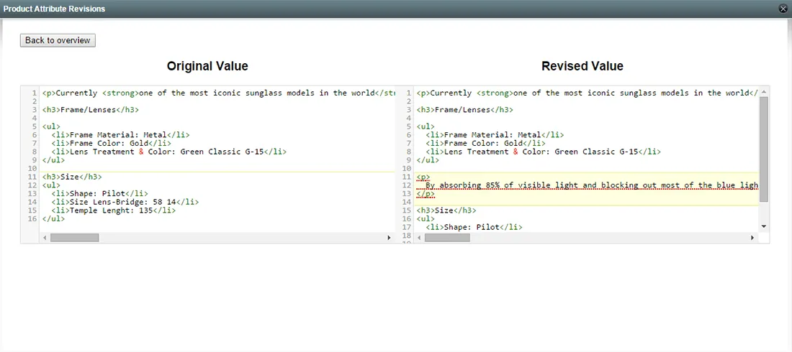
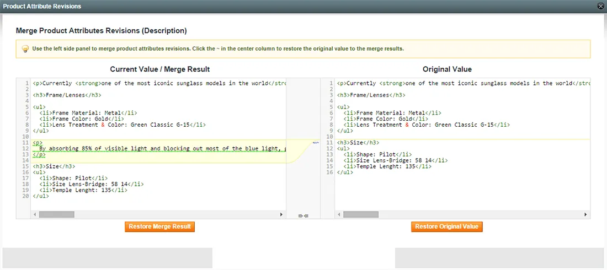
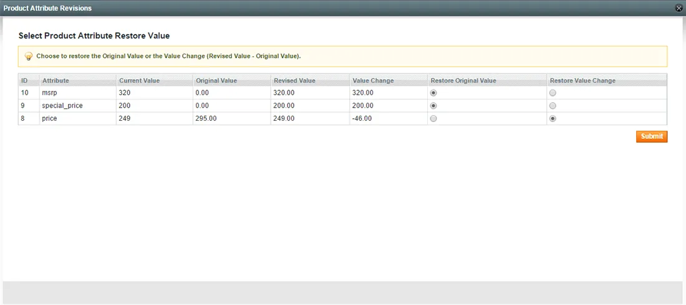
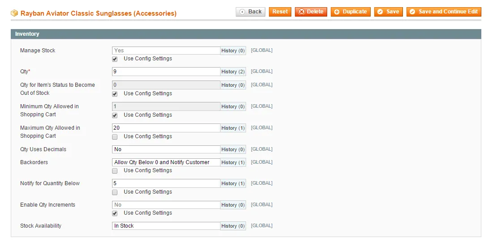
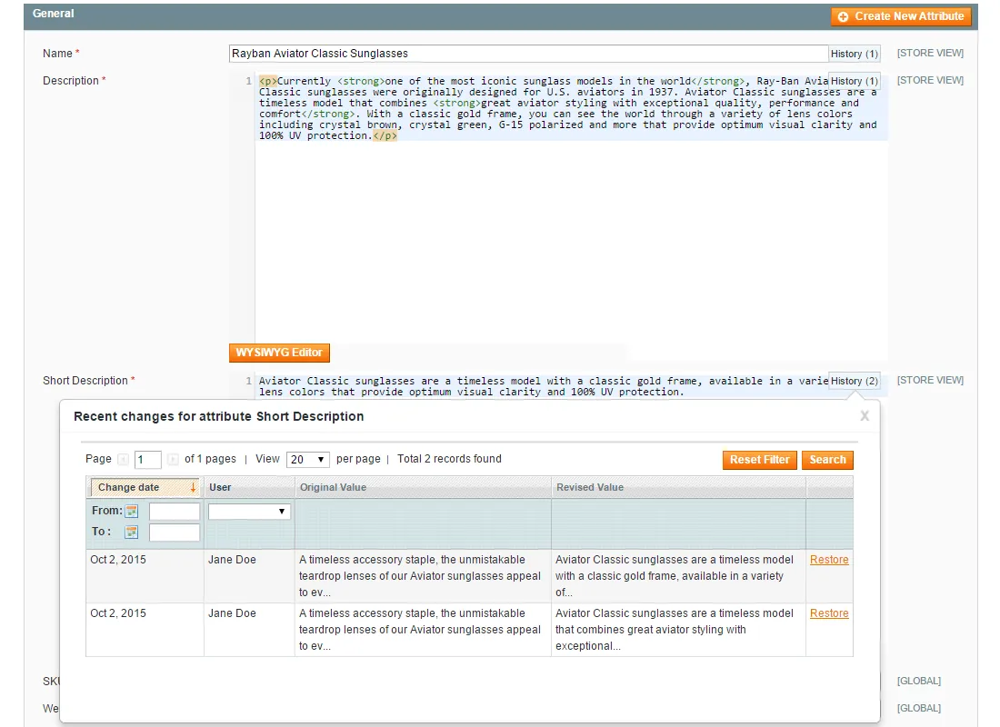

# Product Attribute Revisions for Magento 1 / OpenMage

**Revision history for Magento product attributes, with restore.**



Saves a revision of every product attribute change when a product is saved.

See who changed what and when, compare text changes and restore earlier values from the product edit page.

> [!NOTE]
> Product Attribute Revisions is free and open source under the MIT License (since 2026). Plugin Company no longer actively develops this extension, but issues and pull requests are welcome.

## Features

- Revision of every attribute change on product save
- Shows who made each change and when
- Restore a single value from a pop-over next to the attribute
- Restore multiple values in the attribute revisions tab
- Merge panel for text attribute revisions
- Undo price and stock changes with one click
- Restore an earlier attribute version at any time

## Screenshots

<table>
  <tr>
    <td width="50%" valign="top"><br><sub>Restore product attribute revisions</sub></td>
    <td width="50%" valign="top"><br><sub>Compare product attribute revisions</sub></td>
  </tr>
  <tr>
    <td width="50%" valign="top"><br><sub>Merge product attribute revisions</sub></td>
    <td width="50%" valign="top"><br><sub>Restore product attribute values</sub></td>
  </tr>
  <tr>
    <td width="50%" valign="top"><br><sub>Change history per product attribute</sub></td>
    <td width="50%" valign="top"><br><sub>Product attribute version history</sub></td>
  </tr>
</table>

## Compatibility

- **Magento:** Community Edition 1.4.x – 1.9.x, Enterprise Edition 1.8.x – 1.14.x
- **Latest version:** 1.1.4 (released 2018-03-29)
- **Composer package:** `plugincompany/magento1-product-attribute-revisions`
- **Module:** `Monkebusiness_Rollback`

## Installation

### modman

```bash
cd /path/to/magento
modman init   # once per Magento installation
modman clone https://github.com/PluginCompany/magento1-product-attribute-revisions.git
```

modman creates symlinks, so enable *Allow Symlinks* under System > Configuration > Advanced > Developer > Template Settings.

### Composer

With [magento-hackathon/magento-composer-installer](https://github.com/Cotya/magento-composer-installer) (it reads the `modman` file of this repository):

```bash
composer config repositories.plugin.company composer https://plugin.company/
composer require plugincompany/magento1-product-attribute-revisions
```

Your project `composer.json` needs the Magento root directory in its `extra` section (and, with Composer 2.2+, the installer plugin allowed), for example:

```json
{
    "extra": { "magento-root-dir": "./" },
    "config": { "allow-plugins": { "magento-hackathon/magento-composer-installer": true } }
}
```

### Manual installation

Download the ZIP of the latest release from the [tags page](https://github.com/PluginCompany/magento1-product-attribute-revisions/tags) ([1.1.4](https://github.com/PluginCompany/magento1-product-attribute-revisions/archive/refs/tags/1.1.4.zip)) and copy the `app/`, `js/` folders into your Magento root:

```bash
unzip magento1-product-attribute-revisions-1.1.4.zip
cp -R magento1-product-attribute-revisions-1.1.4/app magento1-product-attribute-revisions-1.1.4/js /path/to/magento/
```

Step-by-step instructions are in the [installation guide](docs/02-installing-the-magento-extension.md).

### After installing

Clear the cache (System > Cache Management, or `rm -rf var/cache/*`), then log out of the admin and log in again so the new configuration sections and permissions are loaded.

### Upgrading from a purchased copy

Replace the old files with this release. No license key is needed; your settings and data stay as they are.

## Documentation

- [Documentation in this repository](docs/README.md) (Installation Guide, User Manual)
- Online documentation: <https://plugin.company/knowledge-base/docs/magento-product-attribute-revisions/>
- Product page: <https://plugin.company/magento1-extensions/product-attribute-revisions.html>

## Changelog

See [CHANGELOG.md](CHANGELOG.md) for the release history.

## Contributing

Found a bug or have an improvement? Please open an [issue](https://github.com/PluginCompany/magento1-product-attribute-revisions/issues) or send a [pull request](https://github.com/PluginCompany/magento1-product-attribute-revisions/pulls). Since the extension is no longer actively developed by Plugin Company, fixes from the community are the best way to keep it working on current Magento 1 / OpenMage and PHP versions.

## License

Plugin Company's code in this repository is released under the [MIT License](LICENSE), Copyright (c) 2014-2026 Plugin Company.

Bundled third-party libraries keep their own licenses; see [THIRD-PARTY-NOTICES.md](THIRD-PARTY-NOTICES.md) for the full list.

In particular:

- A few files are copies or adaptations of Magento core code and keep their original Magento license headers (OSL-3.0 / AFL-3.0).
