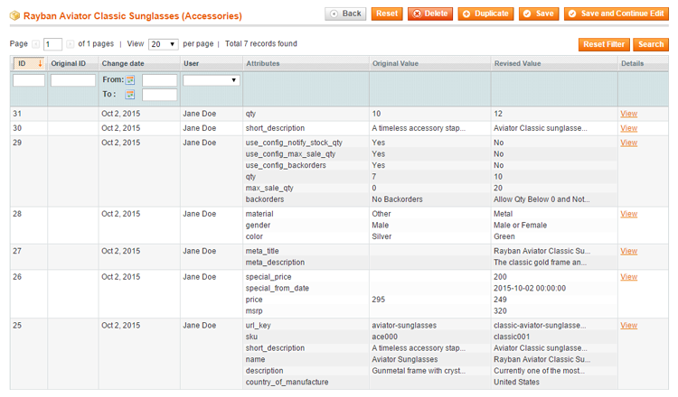

# Managing Product Revisions

After installing Magento Product Attribute Revisions, the extension will automatically create a revision record each time a product attribute change is saved.

A revision record can contain multiple attribute changes, which can all be selected and restored separately.

To view and manage the attribute revisions of a product, navigate to **Catalog > Manage Products** in the top Admin Panel menu, select a product from the list and click **Product Attribute Revisions** in the product view menu.

The Product Attribute Revisions tab shows an overview of all attribute revisions of the selected product, including the change date, user name and attribute ID, followed by the original value of the attribute (before the previous revision) and the revised value.

You can view the details of each attribute revision by clicking the 'View' link in the 'Details' column, opening a new window in which you can edit and restore the revision.

---

[Documentation index](./README.md) · [README](../README.md) · [Online version](https://plugin.company/knowledge-base/docs/magento-product-attribute-revisions/user-manual/managing-product-revisions/)
