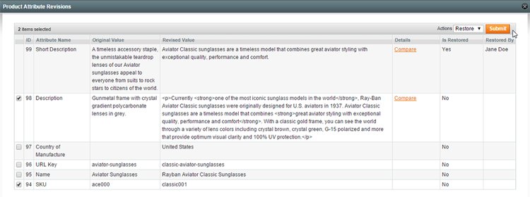
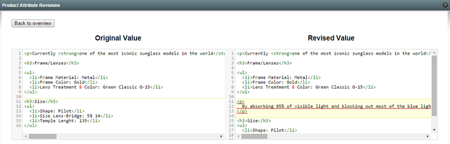
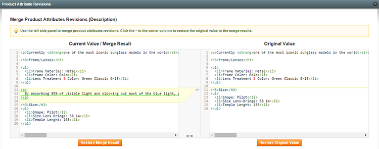
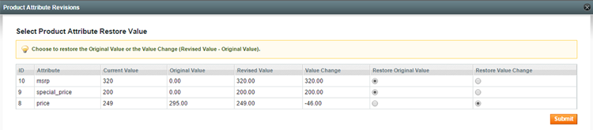

# Restoring Product Revisions

To restore a product attribute revision, click the 'View' link in the 'Details' column of the Product Attribute Revisions tab. A new window will open showing the additional details of the revision(s), including the restore history.

With some text attributes such as product descriptions you can compare the changes by clicking the 'Compare' link in the 'Details' column.

To restore a revision, select one or multiple attribute(s) from the overview, select 'Restore' from the 'Actions' dropdown menu and click 'Submit'. Revisions that have already been restored, cannot be restored a second time.

Depending on the selected attribute type, a new window might open with additional restore options (see below).

## Editing and Merging Text Attributes

When restoring a text attribute such as a product description, a new window will open in which you can optionally edit or merge the revision before restoring it.

The original value (the value before the previous revision) is shown in the right hand panel and the current value is shown on the left.

You can directly restore the revision by clicking the 'Restore Original Value' button.

The left hand panel can be used to edit or merge the current value before restoring it.

Click the ~~ in the center column to restore a chunk from the original value to the merge panel.

Click the 'Restore Merge Result' button to restore the edited revision or merge result.

## Restoring Numerical Attributes

When restoring numerical attributes such as prices or inventory amounts, a new window will open in which you can choose to restore the original value (the value before the previous revision) or the value change (revised value - original value).

Restoring the value change can be useful when correcting amounts that have already been revised in the mean time.

---

[Documentation index](./README.md) · [README](../README.md) · [Online version](https://plugin.company/knowledge-base/docs/magento-product-attribute-revisions/user-manual/restoring-product-revisions/)
