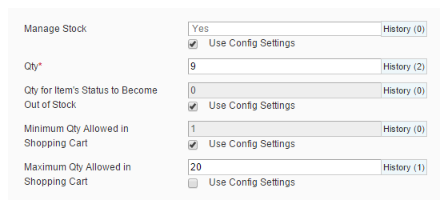
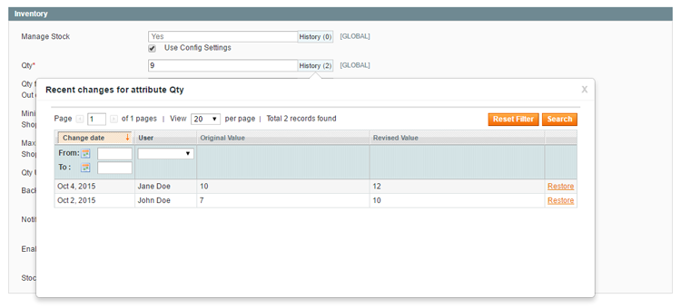

# Viewing the Product Attribute History

Besides the option to view all attribute revisions that have been made per product in the [Product Attribute Revisions tab](./04-managing-product-revisions.md), it's also possible to view the change history per attribute by clicking the 'History' button next to the attribute field.

The amount of revisions made to an attribute is shown on the right side of the 'History' button, for example '(2)'.

By clicking the 'History' button a pop-over will appear showing the product attribute revisions, with the most recent changes at the top of the overview.

Click the 'Restore' link on the right to restore a revision, following the same steps as described in the [previous chapter](./05-restoring-product-revisions.md).

---

[Documentation index](./README.md) · [README](../README.md) · [Online version](https://plugin.company/knowledge-base/docs/magento-product-attribute-revisions/user-manual/viewing-the-product-attribute-history/)
